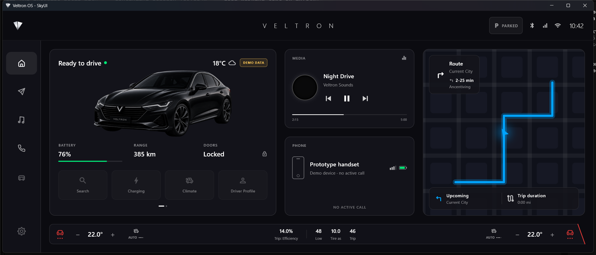
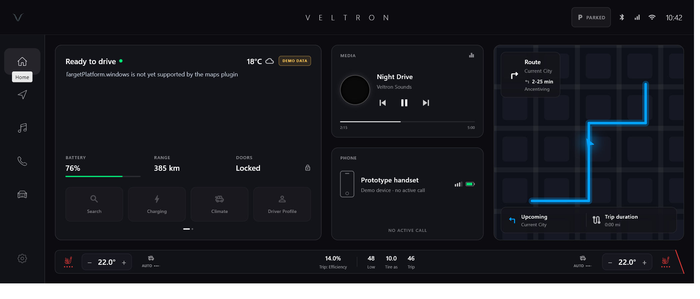
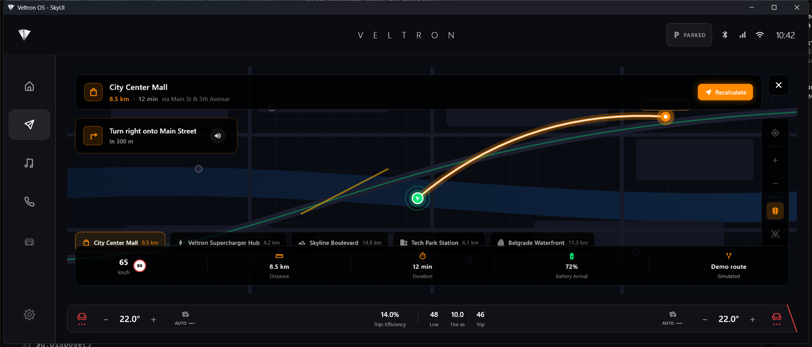
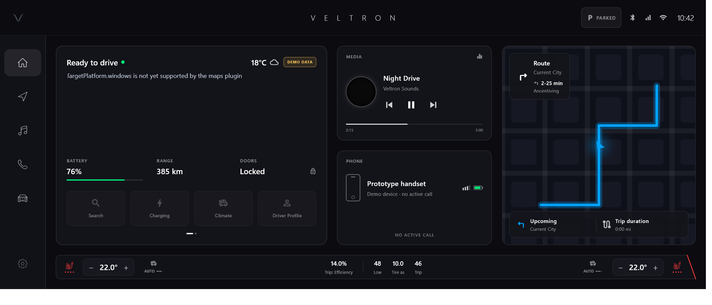
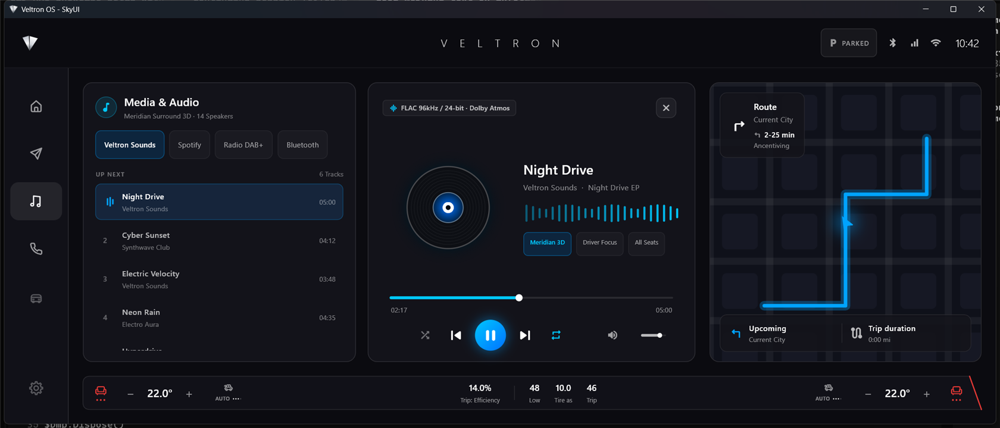
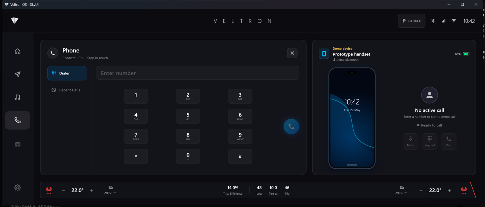
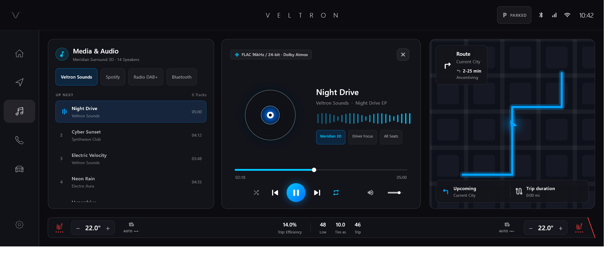

# Veltron Auto — SkyUI HMI Concept

<p align="center">
  
</p>

<p align="center">
  <strong>Automotive-Grade HMI Concept Direction</strong><br/>
  Veltron Auto V1 SportLine digital cockpit prototype
</p>

<p align="center">
  
  
  
  
</p>

## Executive overview

SkyUI is an internal Flutter HMI prototype for the future Veltron ecosystem. It provides a dark cockpit dashboard and local prototype Navigation, Media, Phone, Vehicle, and Climate experiences.

All vehicle, phone, navigation, media, climate, connectivity, speed, route, trip, and diagnostic values are fixtures or local UI state unless explicitly identified as an implemented integration.

## Screenshots

Running client prototype (`docs/screenshots/`), before and after the icon/logo overhaul
(every sidebar glyph replaced with the user-supplied filled punches; metallic `V` logo
from `logo.ico` now the app icon and the sidebar logo).

| Screen | Before | After |
| --- | --- | --- |
| Home dashboard |  |  |
| Navigation (simulated demo route) |  |  |
| Media & Audio |  |  |
| Phone dialer |  |  |
| Vehicle | — |  |

Images are captured at 2100×900 (151.2% scaling).

## Veltron Auto context

Veltron Auto is presented publicly as an independent automotive R&D studio based in Belgrade, Serbia, led by Boris Vlajnić, Founder and Automotive Design Director. Its stated focus is automotive design, UX, digital cockpit architecture, aerodynamics, propulsion concepts, and accessible performance.

Public studio reference: [veltroncars.com](https://veltroncars.com).

V1 SportLine is the studio's performance concept. SkyUI represents the HMI and digital-cockpit pillar of that concept: a driver-centered interface that connects information and control with the vehicle's intended character.

The ambition is an automotive-grade design direction. That means the interface should be built to automotive standards and expectations; it does not mean that this prototype has passed automotive certification, safety assessment, or vehicle validation.

> **Prototype boundary:** SkyUI is not a vehicle controller, production infotainment platform, certified automotive HMI, cybersecurity-assured release, or fully offline runtime. The only current evidence boundary is a 1680×720 landscape widget and headless-browser smoke test. Physical-display, resolution-matrix, accessibility, performance, lifecycle, safety, security, hardware, and compliance validation remain pending.

The current application implements no backend, remote telemetry, crash reporting, analytics, vehicle-signal collection, or cloud synchronization.

## Current status

| Module or system | Status | Current boundary |
| :--- | :---: | :--- |
| System shell and dark theme | Prototype | Connected `AppTheme`; much of the UI still uses inline style values |
| Dashboard layout | Smoke-tested at 1680×720 | Fixed 7:4:5 baseline; no physical-display or resolution-matrix validation |
| Header and sidebar | Prototype | Simulated status values, debug-only drive mode, and explicit disabled destinations |
| Vehicle card | Demo data | Static render and fixtures; no CAN/OBD source; quick actions are disabled |
| Media studio | Local simulation | Source, queue, playback, and audio labels are local state; no audio HAL or persistent session |
| Phone cockpit | Local simulation | Dialer, synthetic recents, and explicit demo call; no telephony, contacts, DTMF, or carrier service |
| Navigation | Local simulation | Custom map and fixture destinations; no GPS, map provider, routing engine, or live traffic |
| Climate bar | Local simulation | Visual controls only; no HVAC commands, validated limits, or automatic regulation |
| Local web launcher | Development tool | Loopback server, CSP-compatible build, local CanvasKit, and enforced build stamp |
| Android release | Blocked | Placeholder `com.example.skyui` identity and debug signing |
| Hardware, CAN, OTA, AI, backend | Not integrated | No service, trust boundary, or production contract exists |

Vehicle and Settings sidebar entries are visibly disabled because their screens do not exist. Unsupported map camera controls and unavailable vehicle actions are also disabled rather than presented as working features.

## Implemented prototype behavior

### Shell and transitions

- Persistent Header, Sidebar, Home dashboard, and Climate bar.
- One coordinated expanded module at a time: Navigation, Media, or Phone.
- Latest destination request wins during rapid navigation.
- System Back closes an expanded module instead of leaving the root route.
- An active demo call blocks module navigation until the call is ended.
- Vehicle and Settings are disabled placeholders.

### Media

- Local source selection, queue selection, playback position, volume, mute, shuffle, repeat, and sound-stage state.
- Source and audio-format labels are fixtures; no stream, decoder, speaker telemetry, or audio HAL is connected.
- The playback timer stops while paused.
- The waveform uses a custom painter rather than rebuilding 24 widgets per frame.
- Playback state does not survive Media overlay teardown.

### Phone

- Dialer and synthetic Recent Calls tabs with different content.
- Selecting a recent entry fills the number but does not start a call.
- An explicit Call action starts a local demo-call state machine.
- The keypad is number entry, not DTMF.
- Contacts, Voicemail, telephony, carrier state, and the in-call keypad are not implemented.
- Mute is local state and is enabled only during the demo call.
- The call state belongs to the Phone widget and is not a durable telephony session.

### Navigation

- Custom-painted map, fixture destinations, and local destination transition.
- Simulated maneuver, speed, limit, ETA, distance, and arrival values.
- Traffic toggles a painted fixture layer; it is not a traffic feed.
- Recalculate replays motion to the selected fixture destination; it does not calculate a route.
- Zoom, Recenter, and 3D controls are disabled until a real map-camera model exists.

### Vehicle and climate

- Vehicle battery, range, doors, weather, trip, and tire values are fixtures.
- Vehicle quick actions are disabled.
- Climate values are local visual state with no vehicle-specific limits or HVAC command path.

## Current project structure

```text
lib/
├── core/
│   ├── icons/
│   └── theme/
├── screens/
│   ├── home/
│   ├── media/
│   ├── navigation/
│   └── phone/
├── services/
│   └── drive_mode_service.dart
├── widgets/
│   ├── cards/
│   ├── climate/
│   ├── header/
│   └── sidebar/
└── main.dart

test/
└── widget_test.dart

web/
└── flutter_bootstrap.js
```

`DriveModeService` is a debug/demo notifier used by the Media browsing guard. It is not a vehicle state, trust, or safety source. There is currently no `lib/models/` directory or shared media, call, route, climate, or hardware session layer.

## State ownership

| Concern | Current owner | Lifetime |
| :--- | :--- | :--- |
| Expanded dashboard destination | `HomeScreen` state | Root app route |
| Demo call | `PhoneScreen` state | Phone overlay |
| Media playback and queue | `MediaScreenContent` state | Media overlay |
| Navigation destination | `NavigationScreenContent` state | Navigation overlay |
| Climate controls | Local widget state | Home widget lifetime |
| Debug parked/driving state | `DriveModeService` | Process lifetime |
| Compact media progress | `MediaCard` fixture state | Card lifetime |

This is prototype state ownership, not a completed domain/session architecture.

## Getting started

### Prerequisites

- Flutter SDK compatible with Dart `>=3.12.0 <4.0.0`.
- The HMI audit was performed locally with Flutter `3.44.4`; other SDK versions are untested unless recorded in a later verification report.
- Python 3 for the local web-app launcher.
- Google Chrome or Microsoft Edge in a standard installation path for preferred app-window mode.

### Fetch dependencies

```bash
flutter pub get
```

### Run the local simulator

```bash
run_app.bat
```

Or:

```bash
python run_app.py
```

The launcher always runs:

```bash
flutter build web --release --no-web-resources-cdn --csp
```

It then serves only on `127.0.0.1`, validates the generated bundle, writes a hash-based build stamp, and opens Chrome or Edge app-window mode when available. If no supported browser path is found, it may open a normal browser tab.

CanvasKit is local, but the current Flutter web fallback-font path may still use `https://fonts.gstatic.com`. Fully offline operation is not claimed until approved fonts are bundled locally and a network trace confirms zero external fetches.

### Native development targets

```bash
flutter run -d windows
flutter run -d chrome
```

These are development targets only. Android release configuration currently uses placeholder identity and debug signing; other platform signing, notarization, permissions, and hardware behavior are unverified.

## Verification currently completed

- `flutter analyze` passes.
- Nine Flutter tests pass.
- `python -m py_compile run_app.py` passes.
- The enforced CSP-compatible web release build passes.
- The loopback server returns security headers and rejects an untrusted Host header.
- Headless Chrome renders the 1680×720 dashboard under the configured CSP.
- The detailed audit is recorded in `docs/automotive_hmi_audit.md`.

These checks do not establish target-device performance, accessibility, safety, security compliance, or vehicle readiness.

## Release warning

Android release artifacts must not be distributed while the application identity and signing configuration remain unresolved. The current `com.example.skyui` package ID and debug signing key are development placeholders.

Before any pilot or vehicle connection, close the release gates in `docs/automotive_hmi_audit.md`, including legal classification, reproducible build, supply-chain controls, production signing, TARA/HARA, driver-interaction policy, durable session contracts, signal validity, target-platform validation, and non-actuating HIL/vehicle testing.

## Documentation

- [Automotive HMI audit](docs/automotive_hmi_audit.md)
- [Architecture](docs/architecture.md)
- [Design system](docs/design_system.md)
- [Module catalog](docs/modules.md)
- [Roadmap](docs/roadmap.md)
- [Changelog](docs/changelog.md)
- [Draft prototype notice](docs/terms_of_service.md)

## Prototype and testing notice

SkyUI is intended for parked evaluation, desktop simulation, and controlled non-road development. It must not be used as a live driving interface, primary cluster, safety control, driver-monitoring aid, or vehicle actuator gateway.

The current build is provided as-is for internal evaluation. The repository notice is not a substitute for legal review, corporate authorization, vehicle approval, or a complete distribution agreement.
